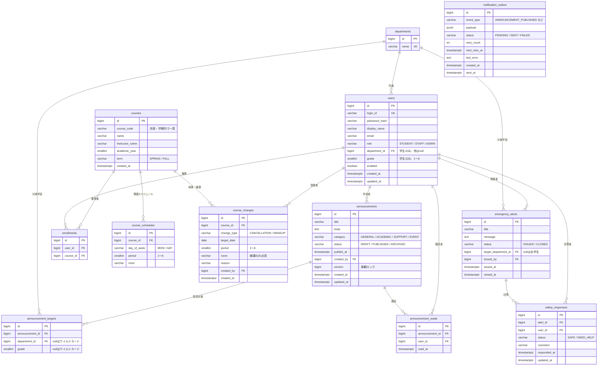
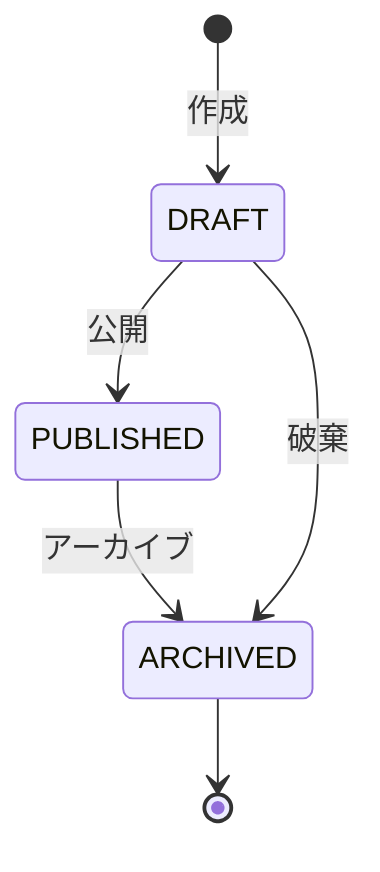
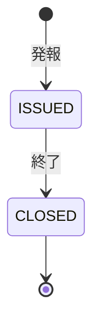

# キャンパス情報アプリ 設計書

| 項目 | 内容 |
|---|---|
| ドキュメント版 | 0.1(初版・たたき台) |
| 作成日 | 2026-10-25 |
| 対象リポジトリ | `campus-info-app`(`backend/` に Spring Boot、将来 `frontend/` を追加) |
| 位置づけ | 学習・ポートフォリオ用のオリジナル設計。実在の大学・組織・データは一切使用しない |

> 本書は、公開されている「大学向け公式アプリ」の事例(学務情報の一元化、お知らせ配信、時間割、休講情報、安否確認など)で語られている課題と機能の考え方を参考に、**架空の大学向けに独自に設計したもの**です。画面・名称・文言・データは参考元とは無関係です。

---

## 1. 目的と背景

### 1.1 解決したい課題

大学では、お知らせ・履修・休講・緊急連絡などの情報が複数の場所に分散し、学生が必要な情報を見つけにくく、大学側も「届いたか」を把握しにくい。

### 1.2 アプリの目的

- 学生に、**自分に関係のある情報だけ**を一か所で届ける
- 教職員に、**配信・休講登録・既読/回答状況の把握**を一か所で行わせる
- 緊急時に、**連絡と安否確認を素早く行い、未回答者を把握できる**ようにする

### 1.3 このプロジェクトで示したいこと(開発側の目的)

| 観点 | 示したい内容 |
|---|---|
| Java / Spring Boot | 層構造、DI、バリデーション、例外設計、トランザクション、楽観ロック |
| 設計力 | 要件 → 機能 → API → データ設計への落とし込み、設計判断の説明 |
| 品質 | 単体テスト・結合テスト(実DB)、CI |
| 実務の作法 | 認証認可、オブジェクト単位の権限制御、PR運用、ドキュメント |
| 環境非依存 | AWS以外のクラウド/SaaS(通知連携・デプロイ)での動作 |

---

## 2. スコープ

### 2.1 優先度の定義

| 優先度 | 意味 |
|---|---|
| Must | これがないと成立しない。必ず完成させる |
| Should | 完成度を高める。時間が許す限り実装する |
| Could | 余力があれば。設計のみ・未実装でも可 |

### 2.2 対象外(やらないこと)

- 実在の学内システム・認証基盤との連携(学内SSO、履修登録システム等)
- 成績管理、出欠管理、学費・奨学金の申請
- ネイティブモバイルアプリ(iOS/Android)。Web(レスポンシブ)で提供する
- プッシュ通知の端末個別配信(通知は外部SaaS経由のチャネル通知とする)
- 実在の個人情報の取り扱い(デモデータはすべて架空)

---

## 3. ユーザーとロール

| ロール | コード | 想定ユーザー | 主な目的 |
|---|---|---|---|
| 学生 | `STUDENT` | 学部生 | 自分宛の情報を確認し、安否確認に回答する |
| 教職員 | `STAFF` | 教務担当の職員 | お知らせ配信、休講・補講の登録、既読状況の確認 |
| 管理者 | `ADMIN` | システム管理者・危機管理担当 | ユーザー・講義管理、安否確認の発報と集計 |

- 1ユーザーにつきロールは1つ。
- `STAFF` は「教務担当」であり、特定講義の担当教員は表現しない(単純化のため)。

---

## 4. 機能要件

### 4.1 機能一覧

| ID | 機能 | 概要 | 優先度 | 対象ロール |
|---|---|---|---|---|
| AUTH-01 | ログイン | ログインIDとパスワードで認証し、トークンを発行する | Must | 全員 |
| AUTH-02 | アクセス制御 | ロールおよびデータ所有に基づき操作を制限する | Must | 全員 |
| USR-01 | ユーザー管理 | ユーザーの登録・一覧(API中心。画面は持たない) | Must | ADMIN |
| ANN-01 | お知らせ作成・編集 | タイトル・本文・カテゴリ・公開日時を登録(下書き) | Must | STAFF, ADMIN |
| ANN-02 | 配信対象の指定 | 学部・学年で対象を絞る。指定なしは全員 | Must | STAFF, ADMIN |
| ANN-03 | 公開・アーカイブ | 下書き → 公開 → アーカイブ | Must | STAFF, ADMIN |
| ANN-04 | お知らせ閲覧 | 学生は自分が対象のものだけ一覧・詳細を閲覧 | Must | STUDENT |
| ANN-05 | 既読管理 | 詳細を開いた時点で既読を記録(冪等) | Must | STUDENT |
| ANN-06 | 既読統計 | 対象者数に対する既読数・既読率の参照 | Should | STAFF, ADMIN |
| TT-01 | 時間割表示 | 履修している講義を曜日・時限で表示 | Must | STUDENT |
| TT-02 | 講義・履修の登録 | 講義、開講曜日・時限、履修の登録(API/初期データ) | Must | ADMIN |
| CHG-01 | 休講・補講の登録と取消 | 講義と日付を指定して休講・補講を登録、取消 | Must | STAFF, ADMIN |
| CHG-02 | 休講・補講の閲覧 | 学生は自分の履修講義の変更のみ閲覧。職員は全件 | Must | STUDENT, STAFF, ADMIN |
| EMG-01 | 安否確認の発報 | タイトル・本文・対象(全学生/学部)を指定して発報 | Should | ADMIN |
| EMG-02 | 安否の回答 | 「無事 / 要支援」とコメントを回答。終了までは更新可 | Should | STUDENT |
| EMG-03 | 集計と未回答者の把握 | 回答区分ごとの件数、未回答者の一覧 | Should | ADMIN, STAFF |
| EMG-04 | 安否確認の終了 | 終了後は回答の追加・更新を不可にする | Should | ADMIN |
| NTF-01 | 外部SaaS通知 | お知らせ公開・休講登録・安否発報をSlackチャネルへ通知 | Should | システム |
| NTF-02 | 通知の再送 | 送信失敗時に再試行し、結果を記録(Outbox) | Should | システム |
| SYS-01 | ヘルスチェック | 稼働状態の確認エンドポイント | Must | 公開 |
| SYS-02 | API仕様の公開 | OpenAPI(Swagger UI)でAPI仕様を確認できる | Should | 開発者 |
| LOG-01 | 学修の振り返り記録 | 学生が日々の学びをメモとして記録 | Could | STUDENT |
| SUP-01 | 相談窓口ナビ | 窓口情報の一覧表示 | Could | STUDENT |

### 4.1.1 機能IDと設計項目の対応(API・画面に現れないもの)

| 機能ID | 設計の記載場所 | 備考 |
|---|---|---|
| AUTH-02 | 8章(権限設計) | 全APIに横断して適用。個別のエンドポイントは持たない |
| NTF-01, NTF-02 | 7.4(通知イベント)、9.1(構成)、11.6 | 内部の定期処理で、公開APIは持たない |
| LOG-01, SUP-01 | なし | Could のため、API・画面・テーブルは未設計。着手する場合に追加する |

### 4.2 主なユーザーストーリー

| ID | ストーリー | 受け入れ条件(抜粋) |
|---|---|---|
| US-01 | 学生として、自分の学部・学年向けのお知らせだけを見たい | 対象外のお知らせは一覧に出ず、詳細を直接指定しても取得できない(404) |
| US-02 | 学生として、未読のお知らせが分かるようにしたい | 一覧に既読/未読が表示され、`unreadOnly=true` で未読だけに絞れる |
| US-03 | 職員として、お知らせを下書きで作り、確認してから公開したい | 公開前は学生に見えず、公開後に学生へ表示される |
| US-04 | 職員として、誰がどれだけ読んだか把握したい | 対象者数・既読数・既読率が取得できる |
| US-05 | 職員として、休講を登録したら該当講義の履修者にだけ反映してほしい | 履修していない学生の画面には出ない。開講日でない日付は登録できない |
| US-06 | 学生として、今日・今週の時間割と休講を一緒に確認したい | 時間割と休講・補講が同じ週の範囲で取得できる |
| US-07 | 管理者として、緊急時に学生へ連絡し、未回答者を把握したい | 発報後、回答数と未回答者が確認できる |
| US-08 | 学生として、安否の回答を後から訂正したい | 終了前なら上書き更新でき、終了後は更新できない(409) |

### 4.3 業務ルール

| No. | ルール |
|---|---|
| BR-01 | お知らせが学生に見える条件は、`status = PUBLISHED` かつ `publish_at <= 現在時刻` かつ(対象指定なし、またはいずれかの対象に学生の学部・学年が一致)。対象行の `department_id` / `grade` が `null` の側はワイルドカードとして扱う |
| BR-02 | お知らせの状態遷移は `DRAFT → PUBLISHED → ARCHIVED` と、下書きの破棄(`DRAFT → ARCHIVED`)のみ。公開後に下書きへ戻すことはできない。`ARCHIVED` は学生に非表示 |
| BR-03 | 公開済みお知らせの本文編集は許可する(更新日時を表示)。楽観ロック(`version`)で同時更新を検知する |
| BR-04 | 既読の登録は冪等。同じ `(お知らせ, ユーザー)` は1件のみ。同時リクエストでも重複させない |
| BR-05 | 時限は 1〜6、曜日は `MON`〜`SAT`。同一講義で同じ曜日・時限の重複登録は不可 |
| BR-06 | 休講は、対象日の曜日・時限が講義の開講スケジュールに存在する場合のみ登録可。同じ講義・日付・時限の重複登録は不可 |
| BR-07 | 補講は、日付・時限・教室が必須。過去日の補講は登録不可 |
| BR-08 | 安否確認の対象者は、対象が「全学生」なら全 `STUDENT`、学部指定ならその学部の `STUDENT`。集計は参照時に動的に算出する |
| BR-09 | 安否の回答は `(発報, ユーザー)` につき1件。`ISSUED` の間は上書き更新可、`CLOSED` 後は不可 |
| BR-10 | 回答区分は `SAFE`(無事)と `NEED_HELP`(要支援)。`NEED_HELP` は集計で強調表示する |
| BR-11 | 通知にコメントや個人名などの個人情報を含めない(タイトルとリンクのみ) |
| BR-12 | 日時は UTC で保存し、表示時に JST へ変換する。日付のみの項目(休講日など)は JST の暦日とする |

---

## 5. 画面設計(一覧)

画面は最小限とする。フロントエンドの方式は「未決事項」を参照。API 先行で開発し、画面は後続フェーズで実装する。

| 画面ID | 画面名 | 対象ロール | 主な内容 | 関連機能 |
|---|---|---|---|---|
| S01 | ログイン | 全員 | ID・パスワード入力 | AUTH-01 |
| S02 | ホーム | STUDENT | 未読お知らせ件数、今日の時間割、未回答の安否確認バナー | ANN-04, TT-01, EMG-02 |
| S03 | お知らせ一覧 | STUDENT | 既読/未読、カテゴリ絞り込み、ページング | ANN-04 |
| S04 | お知らせ詳細 | STUDENT | 本文表示(表示時に既読登録) | ANN-04, ANN-05 |
| S05 | 時間割 | STUDENT | 曜日×時限のグリッド、休講・補講の表示 | TT-01, CHG-02 |
| S06 | 安否確認の回答 | STUDENT | 区分選択、コメント、回答済み表示 | EMG-02 |
| S07 | お知らせ管理 | STAFF, ADMIN | 一覧、作成・編集、対象指定、公開、既読統計 | ANN-01〜03, ANN-06 |
| S08 | 休講・補講の登録 | STAFF, ADMIN | 講義検索、日付・時限指定、一覧、取消 | CHG-01, CHG-02 |
| S09 | 安否確認の管理 | ADMIN(参照は STAFF) | 発報、終了、集計、未回答者一覧 | EMG-01, EMG-03, EMG-04 |

講義・ユーザーの登録(TT-02, USR-01)は、初期データ(Flyway の開発用シード)と管理者APIで行い、専用画面は作らない。

---

## 6. API設計

### 6.1 共通仕様

| 項目 | 内容 |
|---|---|
| ベースパス | `/api/v1` |
| 形式 | JSON(UTF-8)。日時は ISO-8601(例: `2026-10-25T14:30:00+09:00`)、日付は `yyyy-MM-dd` |
| 認証 | `Authorization: Bearer <JWT>`。`/auth/login` と `/actuator/health` を除き必須 |
| ページング | `page`(0始まり、既定0)、`size`(既定20、最大100)、`sort`。応答は `{ items, page, size, totalElements }` |
| ID | 内部IDは `bigint`。**他人のIDを指定されても取得できないよう、各リソースで所有・対象の確認を行う** |
| エラー形式 | RFC 9457(Problem Details)。`type` `title` `status` `detail` に加え、アプリ独自の `code` と、入力エラー時の `errors[]`(項目名・理由)を返す |

### 6.2 エンドポイント一覧

#### 認証・ユーザー

| メソッド | パス | 概要 | 権限 | 機能ID |
|---|---|---|---|---|
| POST | `/auth/login` | ログインしてトークンを取得 | 公開 | AUTH-01 |
| GET | `/me` | ログイン中ユーザーの情報 | 認証済み | AUTH-01 |
| POST | `/admin/users` | ユーザー登録 | ADMIN | USR-01 |
| GET | `/admin/users` | ユーザー一覧(ロール・学部で絞り込み) | ADMIN | USR-01 |

#### お知らせ

| メソッド | パス | 概要 | 権限 | 機能ID |
|---|---|---|---|---|
| GET | `/announcements` | 一覧。学生は閲覧可能なもののみ。`unreadOnly` `category` で絞り込み | 認証済み | ANN-04 |
| GET | `/announcements/{id}` | 詳細 | 認証済み | ANN-04 |
| POST | `/announcements` | 作成(下書き) | STAFF, ADMIN | ANN-01, ANN-02 |
| PUT | `/announcements/{id}` | 編集(`version` 必須) | 作成者の STAFF, ADMIN | ANN-01, ANN-02 |
| POST | `/announcements/{id}/publish` | 公開 | 作成者の STAFF, ADMIN | ANN-03 |
| POST | `/announcements/{id}/archive` | アーカイブ | 作成者の STAFF, ADMIN | ANN-03 |
| PUT | `/announcements/{id}/read` | 既読にする(冪等) | STUDENT | ANN-05 |
| GET | `/announcements/{id}/read-stats` | 対象者数・既読数・既読率 | 作成者の STAFF, ADMIN | ANN-06 |

`GET /announcements/{id}` を学生が呼んだ場合は、本人が対象かを確認し、対象外なら存在を隠すため **404** を返す。既読登録は詳細取得とは分離し、副作用を明示する。

#### 講義・時間割

| メソッド | パス | 概要 | 権限 | 機能ID |
|---|---|---|---|---|
| GET | `/courses` | 講義の検索(年度・学期・名称) | STAFF, ADMIN | TT-02, CHG-01 |
| POST | `/courses` | 講義登録(開講曜日・時限を含む) | ADMIN | TT-02 |
| POST | `/courses/{id}/enrollments` | 履修登録 | ADMIN | TT-02 |
| GET | `/me/timetable` | 自分の時間割(`academicYear` `term`) | STUDENT | TT-01 |

#### 休講・補講

| メソッド | パス | 概要 | 権限 | 機能ID |
|---|---|---|---|---|
| POST | `/course-changes` | 休講・補講の登録 | STAFF, ADMIN | CHG-01 |
| DELETE | `/course-changes/{id}` | 取消 | 登録者の STAFF, ADMIN | CHG-01 |
| GET | `/course-changes` | 全件の一覧(期間・講義で絞り込み) | STAFF, ADMIN | CHG-02 |
| GET | `/me/course-changes` | 自分の履修講義の休講・補講(`from` `to`) | STUDENT | CHG-02 |

#### 安否確認

| メソッド | パス | 概要 | 権限 | 機能ID |
|---|---|---|---|---|
| POST | `/emergency-alerts` | 発報 | ADMIN | EMG-01 |
| GET | `/emergency-alerts` | 一覧。学生は自分が対象のもののみ | 認証済み | EMG-02 |
| GET | `/emergency-alerts/{id}` | 詳細(学生は自分の回答状況を含む) | 認証済み | EMG-02 |
| PUT | `/emergency-alerts/{id}/response` | 自分の回答を登録・更新(上書き) | STUDENT | EMG-02 |
| POST | `/emergency-alerts/{id}/close` | 終了 | ADMIN | EMG-04 |
| GET | `/emergency-alerts/{id}/summary` | 区分別件数と未回答数 | STAFF, ADMIN | EMG-03 |
| GET | `/emergency-alerts/{id}/non-respondents` | 未回答者一覧 | STAFF, ADMIN | EMG-03 |

#### システム

| メソッド | パス | 概要 | 権限 | 機能ID |
|---|---|---|---|---|
| GET | `/actuator/health` | ヘルスチェック(`/api/v1` の外) | 公開 | SYS-01 |
| GET | `/v3/api-docs`, `/swagger-ui.html` | API仕様(開発・デモ環境のみ公開) | 公開(環境で制限) | SYS-02 |

### 6.3 主なリクエスト例

`POST /api/v1/announcements`

```json
{
  "title": "後期ガイダンスのお知らせ",
  "body": "10月1日に実施します。",
  "category": "ACADEMIC",
  "publishAt": "2026-10-01T09:00:00+09:00",
  "targets": [
    { "departmentId": 2, "grade": 1 },
    { "departmentId": 3, "grade": null }
  ]
}
```

`targets` を空または省略すると全員が対象。`departmentId` / `grade` が `null` の側はワイルドカード。

`PUT /api/v1/emergency-alerts/{id}/response`

```json
{ "status": "SAFE", "comment": "自宅で待機しています" }
```

### 6.4 エラーコード

| HTTP | code | 発生条件 |
|---|---|---|
| 400 | `VALIDATION_ERROR` | 入力値の不正(必須、文字数、形式) |
| 401 | `UNAUTHORIZED` | 未認証、トークンの期限切れ・不正 |
| 403 | `FORBIDDEN` | ロールまたは所有権により操作不可 |
| 404 | `NOT_FOUND` | リソースが存在しない、または閲覧対象外(存在を隠す) |
| 409 | `INVALID_STATE` | 状態遷移の不正(例: 終了済みの安否確認への回答、下書きに戻す操作) |
| 409 | `OPTIMISTIC_LOCK_CONFLICT` | `version` 不一致(他者が先に更新) |
| 409 | `DUPLICATE` | 重複登録(休講の二重登録、講義スケジュールの重複) |
| 422 | `BUSINESS_RULE_VIOLATION` | 業務ルール違反(開講日でない日付への休講、過去日の補講) |
| 500 | `INTERNAL_ERROR` | 想定外のエラー(詳細はログのみ、応答には出さない) |

---

## 7. データ設計

### 7.1 ER図



`notification_outbox` は他テーブルと外部キーを持たない(イベントのペイロードのみ保持する独立テーブル)。

### 7.2 制約とインデックス

| テーブル | 一意制約 | 主なインデックス | 補足 |
|---|---|---|---|
| departments | `name` | | |
| users | `login_id` | `(department_id, grade)` | `STUDENT` のみ `department_id` と `grade` が必須(アプリで検証、DBは CHECK 制約で補完) |
| courses | `(academic_year, term, course_code)` | `(academic_year, term)` | |
| course_schedules | `(course_id, day_of_week, period)` | | `period` は 1〜6 の CHECK 制約 |
| enrollments | `(user_id, course_id)` | `(course_id)` | |
| course_changes | `(course_id, change_type, target_date, period)` | `(target_date)` | `MAKEUP` は `room` 必須(CHECK 制約) |
| announcements | | `(status, publish_at)` | 楽観ロックに `version` を使用 |
| announcement_targets | | `(announcement_id)` | `null` を含む組み合わせの重複はアプリ側で防ぐ |
| announcement_reads | `(announcement_id, user_id)` | `(user_id)` | 重複は一意制約で最終的に防ぐ |
| emergency_alerts | | `(status, issued_at)` | |
| safety_responses | `(alert_id, user_id)` | `(alert_id, status)` | |
| notification_outbox | | `(status, next_retry_at)` | 再送対象の取得に使用 |

文字列長の目安: `title` 200、`display_name` 100、`login_id` 50、`email` 255、`comment` 500、`reason` 255、`room` 50。`password_hash` は BCrypt(60文字)に余裕を持たせて 100。

### 7.3 状態遷移



お知らせ(`announcements.status`)。公開後に `DRAFT` へは戻せない。



安否確認(`emergency_alerts.status`)。`ISSUED` の間のみ回答を登録・更新できる。

### 7.4 通知イベント(Outbox)

| event_type | 発生契機 | 通知内容(個人情報なし) |
|---|---|---|
| `ANNOUNCEMENT_PUBLISHED` | お知らせの公開 | タイトル、カテゴリ、詳細へのリンク |
| `COURSE_CHANGE_REGISTERED` | 休講・補講の登録 | 講義名、日付、時限、区分 |
| `EMERGENCY_ALERT_ISSUED` | 安否確認の発報 | タイトル、回答画面へのリンク |

業務データの更新と `notification_outbox` への登録を**同一トランザクション**で行う。送信は別スレッドの定期処理がポーリングし、失敗時は指数バックオフで再試行する(上限回数を超えたら `FAILED`)。外部サービスの障害が業務処理を失敗させないための設計。

---

## 8. 権限設計

### 8.1 ロール別の操作可否

| 操作 | STUDENT | STAFF | ADMIN |
|---|---|---|---|
| ログイン・自分の情報の参照 | ○ | ○ | ○ |
| ユーザー登録・一覧 | × | × | ○ |
| 講義・履修の登録 | × | × | ○ |
| 講義の検索 | × | ○ | ○ |
| お知らせの閲覧 | ○(自分が対象のみ) | ○(全件) | ○(全件) |
| お知らせの既読登録 | ○ | × | × |
| お知らせの作成 | × | ○ | ○ |
| お知らせの編集・公開・アーカイブ・既読統計 | × | ○(自分が作成したもの) | ○(全件) |
| 自分の時間割の参照 | ○ | × | × |
| 休講・補講の閲覧 | ○(自分の履修講義のみ) | ○(全件) | ○(全件) |
| 休講・補講の登録 | × | ○ | ○ |
| 休講・補講の取消 | × | ○(自分が登録したもの) | ○(全件) |
| 安否確認の閲覧 | ○(自分が対象のみ) | ○(全件) | ○(全件) |
| 安否確認の回答 | ○ | × | × |
| 安否確認の発報・終了 | × | × | ○ |
| 集計・未回答者の参照 | × | ○ | ○ |

### 8.2 実装方針

- **ロール判定**(メソッドの入口)は Spring Security の `@PreAuthorize` で宣言する。
- **オブジェクト単位の判定**(自分が作成した、自分が対象である、など)は、サービス層でリソースを取得するときの条件に含める。判定を画面や呼び出し側に任せない。
- 学生が対象外のリソースを指定した場合は、存在を知られないよう **404** を返す。ロール不足は **403**。
- 認可の抜け漏れを防ぐため、権限テスト(ロール × エンドポイント × 所有)を結合テストに含める。

---

## 9. アーキテクチャ

### 9.1 構成

```
クライアント(Web)
      │ HTTPS / JSON(Bearer JWT)
      ▼
┌──────────────────────────────┐
│ Spring Boot アプリケーション │
│  Controller → Service → Repository
│       ▲           │
│   DTO/検証    トランザクション・業務ルール
│                   │
│        Outbox 送信ジョブ(定期処理)
└───────┬───────────┬──────────┘
        │           │
   PostgreSQL     Slack(Incoming Webhook)
```

### 9.2 レイヤの責務

| レイヤ | 責務 | やらないこと |
|---|---|---|
| Controller | リクエストの受け取り、入力検証(Bean Validation)、DTO への変換、HTTP ステータスの決定 | 業務ルール、トランザクション制御 |
| Service | 業務ルール、トランザクション境界、権限(オブジェクト単位)の判定、Outbox 登録 | HTTP の知識(ステータスコードなど) |
| Repository | 永続化。Spring Data JPA | 業務判断 |
| Domain(Entity) | 状態遷移など、そのオブジェクト自身の不変条件 | |
| DTO | API の入出力。Entity を直接外へ出さない。Java の `record` で定義する | |

### 9.3 パッケージ構成(機能単位)

```
io.github.<user>.campusinfoapp
├─ common/        共通(例外、エラー応答、日時、ページング)
├─ config/        設定(Security、JPA、スケジューラ)
├─ auth/          ログイン、JWT、現在ユーザーの取得
├─ user/          ユーザー、学部
├─ announcement/  お知らせ、対象、既読
├─ timetable/     講義、開講スケジュール、履修、時間割
├─ coursechange/  休講・補講
├─ emergency/     安否確認、回答
└─ notification/  Outbox、Slack 連携
```

各機能パッケージの内部は `controller` / `service` / `repository` / `domain` / `dto` に分ける。機能間の依存は Service 経由とし、他機能の Repository を直接呼ばない。

### 9.4 技術選定

| 領域 | 採用 | 備考 |
|---|---|---|
| 言語 | Java 21(LTS) | 採用理由は 11.1 参照 |
| フレームワーク | Spring Boot(Initializr で選べる最新の安定版) | Web, Validation, Actuator は導入済み |
| ビルド | Maven(Maven Wrapper) | |
| DB | PostgreSQL | ローカルは Docker Compose |
| 永続化 | Spring Data JPA | フェーズ2で追加 |
| スキーマ管理 | Flyway | フェーズ2で追加。開発用シードも Flyway で管理 |
| 認証認可 | Spring Security + JWT | フェーズ4で追加 |
| API仕様 | springdoc-openapi | Spring Boot のバージョン対応を確認して採用 |
| テスト | JUnit、Mockito、MockMvc、Testcontainers | Spring Boot に同梱の版を使用 |
| CI | GitHub Actions | ビルド・テストを自動化 |
| コンテナ | Docker | アプリのイメージ化。Compose でDBと同時起動 |
| 外部通知 | Slack Incoming Webhook | AWS以外のSaaS連携の第一弾 |
| 静的解析 | SonarQube for IDE(VS Code 拡張) | 無料の範囲、接続なしで使用 |

Lombok は使わない。データクラスは `record`、その他は通常のクラスで記述する。

---

## 10. 非機能要件

| 区分 | 要件 |
|---|---|
| セキュリティ | パスワードは BCrypt でハッシュ化。JWT の有効期限は短く設定(目安: 60分)。秘密情報(JWT 鍵、DB パスワード、Slack Webhook URL)は環境変数で渡し、リポジトリに含めない。デプロイ先は HTTPS 必須。CORS は許可オリジンを明示 |
| 入力検証 | すべての入力を Bean Validation と業務ルールで検証。SQL は JPA のパラメータバインドのみ使用 |
| 個人情報 | 開発・デモのデータはすべて架空。ログにパスワード・トークン・本文を出力しない。通知に個人情報を含めない(BR-11) |
| 性能 | 一覧系はすべてページング。主要な検索条件にはインデックスを付与。N+1 問題を避ける(結合取得または一括取得) |
| 可用性・運用 | `/actuator/health` で状態を確認。外部通知の障害が業務処理を止めない(Outbox) |
| 保守性 | 層構造と機能単位のパッケージ。設定は YAML に集約。スキーマ変更は Flyway のマイグレーションのみで行う |
| 監査性 | 主要テーブルに作成者・作成日時・更新日時を保持。リクエストごとの識別子をログに付与する |
| 互換性 | API はバージョン付きパス(`/api/v1`)。破壊的変更は新バージョンで提供 |

---

## 11. 設計判断メモ

| No. | 判断 | 理由 | 代替案とトレードオフ |
|---|---|---|---|
| 11.1 | Java 21(LTS) | 現場での採用実績と、新しい言語機能(record、switch のパターンマッチ、仮想スレッド)、サポート期間のバランスが良い | Java 17 は実績が多いが機能が一つ古い。Java 25 は最新のLTSだが業務での普及はこれから。将来 25 へ移行する検証を行い、手順を記録する |
| 11.2 | 機能単位のパッケージ + 層構造 | 機能の追加・削除が局所化する。 | 層単位のパッケージは小規模では単純だが、規模が増えると関連コードが散らばる |
| 11.3 | ステートレスな JWT 認証 | API 先行で、フロントエンドの方式に依存しない | セッション方式はログアウトやトークン失効が容易。今回は有効期限を短くし、失効は扱わない(リフレッシュトークンは対象外) |
| 11.4 | Flyway によるスキーマ管理 | 変更履歴がコードとして残り、CI・本番で同じ手順を再現できる | JPA の自動生成は手軽だが、本番では使わない |
| 11.5 | Entity を API に出さず DTO(record)を使う | 内部構造の漏えい防止、API の安定性 | DTO の変換コードが増える |
| 11.6 | 通知は Outbox パターン | 業務データの更新と通知の登録が原子的になり、外部障害の影響を受けない | 同期呼び出しは単純だが、通知失敗でトランザクションが巻き戻る、または通知が欠落する |
| 11.7 | 安否確認の対象者数は動的に集計 | 実装が単純 | 発報後にユーザーの所属が変わると、集計値が変わる。厳密には発報時点の対象者を保存(スナップショット)する方式が正しい。必要になれば `emergency_alert_recipients` を追加 |
| 11.8 | 既読の重複防止は一意制約を最終防衛線とする | 同時リクエストでも重複しない | アプリ側のチェックだけでは競合で重複しうる。一意制約違反は成功として扱う |
| 11.9 | 内部IDは `bigint`(連番) | 単純で性能が良い | 連番は推測されやすい。そのためオブジェクト単位の認可を必須とする。外部公開用に UUID を持たせる案もある |
| 11.10 | 対象外リソースは 404 を返す | 他人のリソースの存在を知らせない | 403 の方が原因が分かりやすいが、情報が漏れる |
| 11.11 | 同時編集は楽観ロック | お知らせ編集の競合を検知し、上書きを防ぐ | 悲観ロックは競合が少ない用途には過剰 |

---

## 12. テスト方針

| 種類 | 対象 | 方法 |
|---|---|---|
| 単体テスト | Service の業務ルール(公開条件、休講の検証、回答の上書き、状態遷移) | JUnit、Mockito。ルールごとに正常系・異常系 |
| 結合テスト | API、DB、認可 | MockMvc、Testcontainers(実際の PostgreSQL)。ロール × エンドポイント × 所有の権限テストを含む |
| マイグレーション | Flyway が空DBから最新まで通ること | 結合テストの起動時に実行 |
| 契約 | エラー応答の形式、ステータスコード | 結合テストで検証 |
| 手動確認 | 画面、通知の実送信 | `.http` ファイル(リポジトリに保存)で動作確認手順を残す |

優先してテストするのは、**業務ルール(BR-01〜BR-12)と認可**。カバレッジの数値より、ルールの網羅を重視する。

### 12.1 完了の定義(機能ごと)

- API の実装、入力検証、認可
- 単体テストと結合テスト(認可を含む)
- OpenAPI で仕様が確認でき、`.http` ファイルに実行例がある
- README または設計書への反映

---

## 13. 開発計画

| フェーズ | 内容 | 完了条件 | 目安 |
|---|---|---|---|
| 0. 土台 | リポジトリ、開発環境、雛形 | 雛形が起動し、`/actuator/health` が `UP`。`main` に反映済み | 完了 |
| 1. 設計 | 本書の確定、README の骨子 | 機能・API・ER・権限がレビュー済み | 1週目 |
| 2. 基盤実装 | Docker で PostgreSQL、JPA、Flyway、共通のエラー処理 | DB に接続して起動。マイグレーションが通る。エラー形式が統一されている | 1〜2週目 |
| 3. 機能実装(Must) | お知らせ、時間割、休講・補講(各機能にテスト) | Must の API が動き、単体・結合テストが通る | 2〜3週目 |
| 4. 認証認可 | Spring Security、JWT、ロール、オブジェクト単位の認可 | 権限テストが通る | 3〜4週目 |
| 5. 外部連携・Should | Slack 通知(Outbox)、安否確認 | 公開・休講・発報が Slack に届き、失敗時に再送される | 4週目 |
| 6. CI/CD・デプロイ | GitHub Actions、Docker 化、AWS以外へ公開 | `main` へのマージでテストが走り、公開URLで動作する | 4〜5週目 |
| 7. 仕上げ | README、構成図、ER図、設計判断、デモ準備 | 説明・デモできる | 5週目 |

### 13.1 削る順序(時間が足りない場合)

1. Could(学修の振り返り、相談窓口ナビ)
2. 画面の作り込み(API と Swagger UI のデモに切り替える)
3. 安否確認の集計の拡張(未回答者一覧を後回し)
4. 外部通知の種類(お知らせ公開のみに絞る)

**残すもの**: お知らせ(対象指定・既読)、時間割と休講、認証認可、テスト、CI、AWS以外へのデプロイ、設計意図を書いた README。

### 13.2 ブランチ・コミット・PR 運用

- ブランチ: `feature/<内容>`、`fix/<内容>`、`chore/<内容>`、`docs/<内容>`。`main` へは PR 経由でマージする
- コミットメッセージ: `feat:` `fix:` `test:` `docs:` `chore:` `refactor:` などの接頭辞を付ける
- PR: 自分で差分を読み、目的・変更点・確認方法を書く。テストが通ってからマージする

### 13.3 開発の進め方(生成AIの利用方針)

- 設計判断と中核の業務ロジックは自分で書く。生成AIは、設計案の比較、定型コードのたたき台、レビューの補助に使う
- 取り込んだコードは、すべて読んで理解してから残す。説明できない部分は書き直す
- 利用方針は README に明記する

---

## 14. デモシナリオ

| 手順 | 操作 | 見せる点 |
|---|---|---|
| 1 | 職員でログインし、「1年生向け」のお知らせを下書き作成 → 公開 | 対象指定、状態遷移、権限 |
| 2 | Slack チャネルに通知が届くことを確認 | 外部SaaS連携、Outbox |
| 3 | 学生(1年)でログインし、未読として見えること、既読にすること | 配信対象、既読の冪等性 |
| 4 | 別学年の学生では見えない(詳細を直接指定しても 404) | オブジェクト単位の認可 |
| 5 | 職員が休講を登録し、履修している学生の時間割に反映されること | 業務ルール、履修による絞り込み |
| 6 | 開講日でない日付への休講登録が拒否されること | バリデーション、エラー設計 |
| 7 | 管理者が安否確認を発報し、学生が回答し、集計と未回答者を確認 | 状態管理、集計 |
| 8 | CI のテスト結果と、デプロイ先のヘルスチェックを見せる | 品質、運用 |

デモ用の学生・職員・管理者、学部、講義、履修は Flyway の開発用シードで用意する(すべて架空のデータ)。

---

## 15. 未決事項

| No. | 内容 | 決める時期 | 選択肢 |
|---|---|---|---|
| Q-01 | フロントエンドの方式 | フェーズ3完了時 | Swagger UI のみ / 最小限の SPA(React 等) / サーバーサイド描画 |
| Q-02 | デプロイ先と DB のホスティング | フェーズ6の前 | Render、Fly.io、Google Cloud Run など。DB は同サービスのマネージド PostgreSQL |
| Q-03 | Slack 以外の外部SaaS連携 | フェーズ5 | メール配信サービスなど。時間があれば追加 |
| Q-04 | 認証トークンの詳細 | フェーズ4 | 有効期限、署名方式、リフレッシュの有無 |
| Q-05 | 安否確認の対象者のスナップショット化 | 必要になった時点 | 11.7 参照 |
| Q-06 | 作業日程に応じたスコープ調整 | 日程確定後 | 13.1 の順で削る |
| Q-07 | springdoc-openapi の採用バージョン | フェーズ2 | 使用する Spring Boot のバージョンに対応した版を確認する |

---

## 16. 用語集

| 用語 | 意味 |
|---|---|
| 休講 | 予定された授業が実施されないこと |
| 補講 | 休講などの代わりに実施される授業 |
| 学部・学年 | 学生の所属。お知らせの配信対象の絞り込みに使う |
| 既読 | 学生がお知らせの詳細を開いたこと |
| 安否確認 | 緊急時に学生が自分の状況を回答する仕組み |
| Outbox | 外部への通知内容を、業務データと同じトランザクションで DB に保存し、後で確実に送る方式 |
| 楽観ロック | 更新時にバージョンを比較し、他者の更新との競合を検知する方式 |
